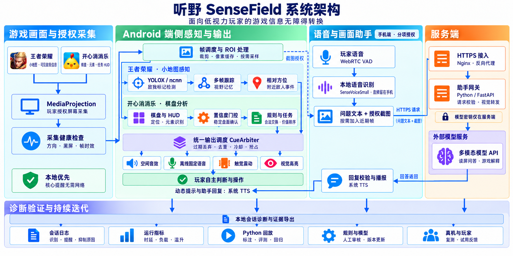

# 听野 SenseField 技术方案

听野运行在 Android 端，为低视力玩家提供游戏信息无障碍转换。系统由授权采集、端侧感知与输出、手机端助手、服务端四部分组成。

## 授权采集

玩家通过 Android MediaProjection 授权屏幕采集。采集服务检查方向、黑屏和画面时效，再按场景调度帧、裁剪 ROI 并复用像素缓存。系统只处理可见画面，不读取游戏进程或内存。

## 王者荣耀：小地图感知

C++ / JNI 链路使用 YOLOX 与 ncnn 识别小地图中的敌我标记，多帧关联后维护位置、可见状态与视野记忆。相对方位和附近敌人事件进入输出调度；重复、过时或证据不足的信息被过滤。

声音、语音与振动遵循玩家设置。本地提醒不依赖云端模型，也不推断画面中未显示的敌方信息。

## 开心消消乐：棋盘分析

端侧处理包括棋盘定位、元素和 HUD 识别、置信度门控及稳定盘面确认。规则层区分外观身份、交换权限与任务贡献，对合法交换排序；未知规则保持未知。

输出以亮框、箭头和方位语音帮助玩家找到操作位置，玩家自行交换或点击。盘面变化、弹窗或停止辅助时撤下旧提示。

## 多通道输出

- 空间音效与固定离线语音表达高频事件。
- 触觉震动和视觉高亮补充声音提示。
- 动态棋盘提示与助手回答使用系统中文 TTS。
- 输出调度处理去重、冷却、过期和抢占，减少提醒之间的冲突。

具体声音、语音与悬浮提示由对应 Android 组件执行，架构图按职责归纳。

## 手机端语音与画面助手

语音输入通过 WebRTC VAD 与 SenseVoiceSmall 在手机处理。用户开启画面理解后，识别文字与授权截图通过 HTTPS 发送到助手服务；需要比较近期变化时才加入近期缩图。原始语音音频不上传。

助手回复经过校验后交由系统 TTS 播放。核心本地提醒与网络问答分别运行；实时游戏事件优先使用本地链路。

## 服务端

Nginx 提供 HTTPS 接入与反向代理，Python / FastAPI 网关负责请求校验、预算和视觉转发。多模态模型由外部模型 API 提供，模型凭据仅保存在服务端私有配置。

回答以可见信息为依据；截图中未见某个目标不等于该目标不存在。助手不执行游戏操作。

## 工具与迭代

Python 工具支持标注、回放、评测和诊断；Java 与 C++ 回归检查端侧行为。新模型和规则经人工审阅、回归与真机验证后发布，不在游戏期间自动训练上线。

[开发指南](../development/团队协作与本地运行.md) · [测试与反馈工具](../../validation/README.md) · [服务端部署](../../deploy/assistant/README.md)
